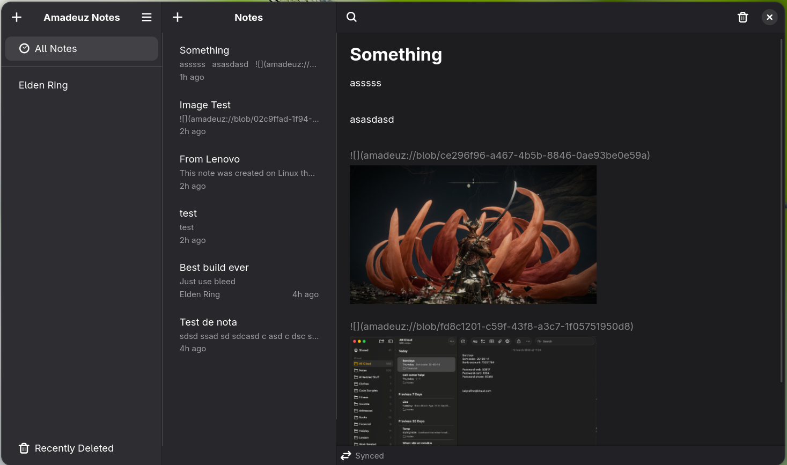
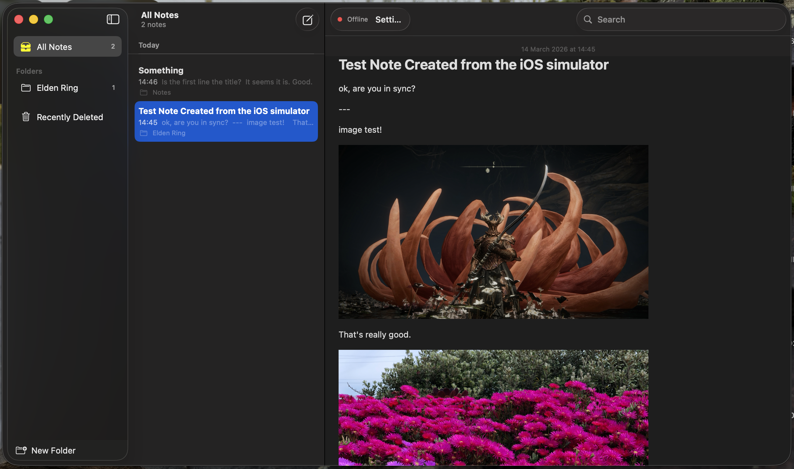

# Amadeuz

An open-source, self-hosted alternative to iCloud, starting with **Notes**.

Your notes live on your devices first and sync through a server you run yourself, such as a
Raspberry Pi, a home NAS or a VPS. Every client is native to its platform: SwiftUI on Apple
devices, and Rust with GTK 4 and libadwaita on Linux. No Electron, no WebViews.

| Linux | macOS |
|---|---|
|  |  |

## Status

Notes is a working app on Linux, macOS and iOS, with a working sync server. The rest of the suite
(files, photos, contacts, calendar) is the long-term goal and hasn't been started.

| | Server | Linux | macOS | iOS | Windows |
|---|:---:|:---:|:---:|:---:|:---:|
| Notes, folders, search, trash | ✅ | ✅ | ✅ | ✅ | ⏳ |
| Offline-first local storage | — | ✅ | ✅ | ✅ | ⏳ |
| Live sync over WebSocket | ✅ | ✅ | ✅ | ✅ | ⏳ |
| Accounts (JWT, recovery codes) | ✅ | ✅ | ✅ | ✅ | ⏳ |
| Inline images, Markdown | ✅ | ✅ | ✅ | ✅ | ⏳ |
| **End-to-end encryption** | ❌ | ❌ | ❌ | ❌ | ❌ |
| **Sharing notes between users** | ❌ | ❌ | ❌ | ❌ | ❌ |

✅ works · ⏳ builds from the Linux codebase, not yet run on Windows · ❌ not implemented

**End-to-end encryption is not implemented yet.** It's planned, but for now the server can read
your notes, so only run it somewhere you trust. Sync merges are last-write-wins per note.

The full feature matrix is in [PROGRESS.md](PROGRESS.md).

## Repository layout

| Path | What it is |
|---|---|
| [`server/`](server/) | Go sync server: REST API, per-note WebSocket, SQLite. See its [README](server/README.md). |
| [`notes/linux/`](notes/linux/) | Linux client (Rust, GTK 4, libadwaita). It also builds for Windows. See its [README](notes/linux/README.md). |
| [`notes/mac/`](notes/mac/) | macOS client (Swift, SwiftUI) |
| [`notes/ios/`](notes/ios/) | iOS client (Swift, SwiftUI) |

## Getting started

1. Run the server by following [`server/README.md`](server/README.md).
2. Build a client. For Linux, see [`notes/linux/README.md`](notes/linux/README.md). The clients
   also work offline with no server at all.

## Design

- [VISION.md](VISION.md): the goals and the principles (native, offline-first, a small protocol,
  self-hosted, end-to-end encrypted) and why Windows ended up on GTK.
- [ICLOUD_NOTES_PROTOCOL.md](ICLOUD_NOTES_PROTOCOL.md): research for a planned iCloud Notes backend in the Linux
  client.
